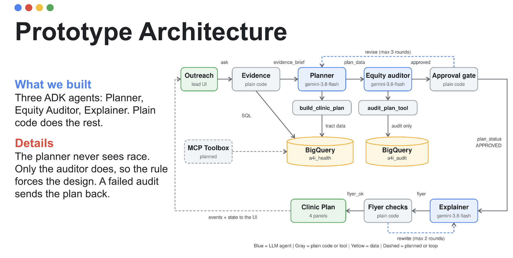

# Curbside: where should the mobile clinic park?

Curbside is a multi-agent system that plans a county mobile clinic's four Saturdays, audits the plan for equity, and writes the flyers a resident can understand. It was built for the Agents for Impact 2026 hackathon (Challenge 5, [brief](docs/challenge-brief.md)) with Google's Agent Development Kit (ADK), Gemini on Vertex AI, BigQuery, and Agent Runtime.

The user is an outreach lead with one van, four Saturdays, and a county of about three hundred census tracts. She needs a defensible answer by Friday, with an explanation she can say out loud.

## What makes it interesting

Most of this project is about being correct under constraints, not about prompting.

- **Models write; code decides.** Ranking, spacing, the equity verdict, approval, and flyer checks are deterministic Python. Gemini only writes prose around tool output, so a model can't approve its own plan.
- **The planner can't see race, and the auditor must.** The planner never receives demographic fields. A separate auditor reads demographic counts through its own service account and checks the plan's output against the county. Each role runs as its own identity with dataset-scoped access, and each has its model request filtered so one role can't read another's reasoning.
- **Every claim carries its scale.** The source tables sit at four resolutions: tract, a 12 km modeling grid, facility point, and multi-county region. Each claim is tagged `TRACT`, `12 KM GRID`, `FACILITY-POINT` or `MULTI-COUNTY REGION`, and measured, modeled, or upper bound. Regional disease data and grid exposure are context only, never a tract ranking factor.
- **It fails closed.** Missing data excludes a factor and reports it; it never counts as zero need. Loops are capped, the run times out at 180 seconds, and anything unresolved goes to a human as `NEEDS_HUMAN` with every draft preserved.
- **Resident copy is machine-checked.** Flyers must keep logistics as placeholders (`[DATE] [TIME] [LOCATION] [CONTACT]`), contain no statistics or group labels in English or Spanish, mark any cost claim `[CONFIRM]`, and stay at or below a grade 6 reading level.

## Architecture

```text
Request → parallel evidence over MCP (Toolbox → BigQuery) → merge
        → [Planner → Equity auditor → Approval gate] × at most 3
        → [Explainer → Flyer checks] × at most 3 → result
```



*Slide from the hackathon presentation. Blue boxes are Gemini agents, gray boxes are plain code, yellow is data, and dashed lines are loops or planned work. Since the slide was made, the MCP Toolbox (shown as planned) has shipped and is the only path from the planner to BigQuery, and the flyer rewrite loop allows three attempts rather than two.*

| Role | Identity | Reads | Job |
|---|---|---|---|
| Planner | `curbside-planner` (through Toolbox) | `a4i_health` only | Calls the deterministic plan tool, writes the calendar |
| Equity auditor | `curbside-auditor` | `a4i_health`, `a4i_audit` | Calls the audit tool, reports its verdict verbatim |
| Explainer | none (no tools) | approved summary only | English and second-language flyer, SMS, health worker script |
| Runtime | `curbside-agent` | neither dataset | Orchestration and token creation for the two tool identities |

The full policy table (thresholds, tie margins, catchments, limits) is in [docs/outreach-planner.md](docs/outreach-planner.md). Those values are demo defaults for review with an outreach lead, not validated public health standards.

## Run it

You need `gcloud`, `uv`, `make`, and a Google Cloud project you can bill. The Makefile's default project is a temporary hackathon lab, so always pass your own.

```bash
make install
make auth
make env PROJECT_ID=<your-project>
bash scripts/load.sh                     # loads the public a4i_health dataset
make setup PROJECT_ID=<your-project>     # APIs, service accounts, roles (review make setup-dry-run first)
make test                                # no cloud credentials needed
make web PROJECT_ID=<your-project>       # ADK web UI on http://127.0.0.1:8000/dev-ui/
```

Submit this as the message (Fulton County, GA, November 2026):

```json
{"county_fips":"13121","month":"2026-11","saturdays":["2026-11-07","2026-11-14","2026-11-21","2026-11-28"]}
```

Deployment (Toolbox on Cloud Run, then the agent on Agent Runtime) and teardown are in [DEPLOYMENT.md](DEPLOYMENT.md). The Leaflet map UI and its proxy are in [frontend/](frontend/README.md); it deploys private by default.

## Tests

`make test` runs the unit suite with scripted models, so it needs no credentials. It covers a real ADK `Runner`, request isolation between roles, contradictory auditor prose, both loop caps, timeout handling, a real MCP stdio transport fixture, scoring invariance, population-weighted audit shares, and the flyer validators. Live evals call Gemini and bill your project; start with one county.

## Repository layout

| Path | Contents |
|---|---|
| `agent/` | Pipeline, scoring, audit, flyer checks, contracts, and the proxy server |
| `toolbox/` | MCP Toolbox config (fixed, read-only evidence SQL) and its container |
| `scripts/` | Loader, audit-data loader, service account setup and teardown |
| `frontend/` | Leaflet map and chat UI |
| `notebooks/` | Data exploration and snapshot publishing |
| `tests/` | Unit, integration, and eval suites |
| `docs/` | Planner policy, deployment notes, original challenge brief |

## Known limits

- Approval is a statement about aggregate coverage, not outcomes. Anchors are tract centroids, not confirmed venues. A person must confirm the venue, hours, cost, services, and eligibility before anything is published.
- Distances are straight-line upper bounds to listed federal sites, not travel time.
- The plan loop's first round uses zero spacing and the audit requires 3 km, so a first draft can be rejected and cost an extra model round trip. Tightening round one is an easy improvement.
- Flyer reading grade uses a vowel-group syllable heuristic, and passing checks can't prove translation accuracy. A human reviews the Spanish copy.
- Only Fulton County has a map-ready frontend; the agent itself takes any county loaded into `a4i_health` and `a4i_audit`.

## Team

Curbside was a group project by team T15 at Agents for Impact 2026.

| Name |
|---|
| Faye Pourghasem |
| Arian Boukani |
| Ilia Kalinichev |
| Nirmal Patel |
| Shubham Patel |

## License

Based on the team repository [2arian3/T15-A4I2026](https://github.com/2arian3/T15-A4I2026). Licensed under Apache 2.0 (see [LICENSE](LICENSE) and [NOTICE](NOTICE)); the public datasets keep their publishers' terms.
